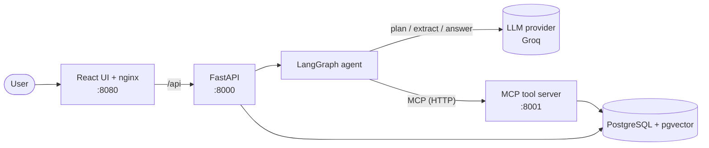
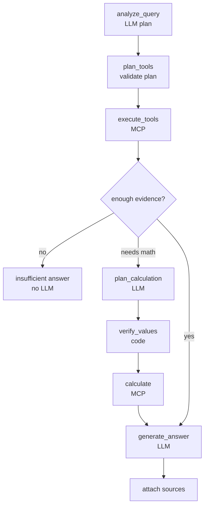

# AI Agentic Research & Document Intelligence Platform

Upload research papers, annual reports or technical PDFs, then ask questions. An LLM-powered **agent** decides which tools it needs,
retrieves evidence with **RAG**, does arithmetic through a sandboxed **MCP** calculator, and answers **with document and page
citations**, or says plainly that the documents do not contain enough evidence.

> **Status: built and tested, with specific things left for you to run.** See [Verification status](#verification-status) for exactly
> what was tested and how, and what was not (notably: Docker was not run, no real Groq call was made, and the UI was never rendered in a browser).

---

## 1. Problem statement
Analysts spend hours searching long PDFs for one figure, then re-checking arithmetic by hand. Plain chatbots answer fluently but
invent numbers and cannot say where a claim came from. A useful assistant must be **grounded** (every claim traceable to a page),
**careful with numbers**, and **honest when it does not know**.

## 2. Objective
Build a production-style, end-to-end AI application, not a toy chatbot, that demonstrates real AI engineering: an agentic workflow
with controlled tool use, retrieval over PostgreSQL/pgvector, a genuine MCP server, a typed API, a usable UI, containerisation,
tests, and a reproducible evaluation harness. Every technology in the stack has a working purpose.

## 3. Key features
- **Grounded answers with page citations**; clickable `[n]` markers open the original PDF at the cited page.
- **Agent with conditional routing** (LangGraph): simple lookups, summaries, metadata questions, calculations, multi-step questions, and "insufficient evidence".
- **Verified arithmetic:** the model extracts figures with *verbatim quotes*; code checks each number appears in its quote before a sandboxed calculator runs.
- **Honest refusals:** weak evidence ends in a templated "not enough evidence" reply, without calling the LLM.
- **Genuine MCP server** with four tools (`search_documents`, `calculate`, `get_document_metadata`, `query_document_database`), read-only DB access, schema-validated inputs.
- **Structure-aware RAG:** page-bounded chunks, heading-aware sections, table rows and column headers preserved, HNSW cosine search.
- **Transparent:** the UI shows the agent's steps, tool calls, timings, the calculation with its quotes, and warnings.
- **Operable:** structured JSON logs with request IDs, `/metrics`, health checks, rate limiting, upload limits, secret redaction.
- **Evaluated:** a 37-question dataset, validator, retrieval and agent evaluation scripts with reports.
- **Provider-pluggable LLM** (Groq first, any OpenAI-compatible endpoint) and swappable embedding model.

## 4. Architecture

Details, request flows, trust boundaries and failure behaviour: [`docs/architecture.md`](docs/architecture.md).

## 5. Technology stack
| Layer | Technology | Purpose in this project |
|---|---|---|
| API | Python 3.12, FastAPI, Pydantic v2 | typed REST API, validation, dependency injection, OpenAPI docs |
| Agent | LangGraph | explicit state machine with conditional routing, retries and refusal branches |
| LLM | OpenAI-compatible client (Groq default) | planning, figure extraction, answer writing; behind an interface |
| RAG | pypdf, custom cleaning/chunking, Sentence Transformers (`all-MiniLM-L6-v2`) | ingestion, embeddings, semantic search |
| Tools | MCP (official `mcp` SDK) | discoverable, isolated, schema-validated tools |
| Data | PostgreSQL 16 + pgvector, SQLAlchemy 2, Alembic | documents, chunks + vectors (HNSW), query/tool logs, migrations |
| UI | React 19, TypeScript, Vite, nginx | upload, chat, citations, workflow trace, dashboard |
| Packaging | Docker, Docker Compose | 4 services, health-gated start-up, isolated networks |
| Quality | pytest, Vitest, ESLint, TypeScript strict | 614 Python + 82 frontend tests, plus a live contract test |

## 6. Agent workflow

The model writes content at four nodes; routing and every safeguard are ordinary code. Full description, including how tools are
selected and how hallucinations are reduced: [`docs/agent_workflow.md`](docs/agent_workflow.md).

## 7. RAG workflow
Validate (type, size, magic bytes, duplicates) -> extract per page -> clean (headers/footers, hyphenation, reflow, tables kept) ->
chunk (page-bounded, heading-aware, overlap) -> embed -> store with page and section -> cosine top-k -> relevance threshold.
See [`docs/rag.md`](docs/rag.md).

## 8. MCP architecture
A separate MCP server process exposes the tools over streamable HTTP (stdio in tests); the backend's client discovers them at
runtime, allow-lists them, and turns every outcome into a structured result. Why MCP rather than plain functions, how to add a tool,
and the security properties: [`docs/mcp.md`](docs/mcp.md).

## 9. Database design
| Table | Holds |
|---|---|
| `documents` | filename, server-generated `storage_name`, `content_hash` (unique), pages, chunk count, PDF metadata |
| `document_chunks` | text, `page_number`, `section_title`, word count, `embedding vector(384)` with an HNSW cosine index; unique `(document_id, chunk_index)`; cascade delete |
| `query_history` | request id, question, status, intent, route, tools used, sources, retrieval/LLM/total latency, error |
| `tool_execution_logs` | per tool call: name, bounded arguments, success, latency, error |
Migrations are Alembic (`0001`, `0002`); `alembic check` shows no drift. ER diagram: [`docs/architecture.md`](docs/architecture.md).

## 10. API endpoints
Base `/api/v1`. Full reference with error codes: [`docs/api.md`](docs/api.md).

| Method | Path | Purpose |
|---|---|---|
| POST | `/documents/upload` | upload and ingest a PDF |
| GET | `/documents` | list (paged) |
| GET | `/documents/{id}` | details + section-to-page map |
| GET | `/documents/{id}/file` | the original PDF (source viewer) |
| DELETE | `/documents/{id}` | delete document, chunks and file |
| POST | `/query` | ask a question (runs the agent) |
| GET | `/queries` | recent questions |
| GET | `/health[?deep=true]` | readiness (DB, pgvector, LLM config, tool server) |
| GET | `/metrics` | outcomes, p50/p95 latency, tool success rates |

**Note: there is no authentication.** Put an authenticating proxy in front before exposing it beyond a trusted network.

## 11. Installation
Requirements: Docker + Docker Compose (recommended), or Python 3.11+, Node 20+ and PostgreSQL 16 with pgvector.
```bash
git clone <your-repo-url> && cd ai-agentic-research-assistant
cp .env.example .env        # then edit it (see below)
```
You need a Groq API key and a model id from the Groq console for `/query` to work. Everything else works without them.

## 12. Environment variables
Copy `.env.example`; it documents every variable. The important ones:

| Variable | Meaning |
|---|---|
| `POSTGRES_PASSWORD` | **required**; database password |
| `GROQ_API_KEY`, `GROQ_MODEL` | **you provide these** (never committed; the API key is redacted from logs). `LLM_PROVIDER=groq`, `GROQ_BASE_URL=https://api.groq.com/openai/v1` |
| `EMBEDDING_MODEL`, `EMBEDDING_DIM` | default `sentence-transformers/all-MiniLM-L6-v2`, 384 (dimension is fixed in the schema) |
| `EVIDENCE_MIN_SCORE` | relevance threshold, default `0.20`, **untuned**: calibrate with the evaluation |
| `MAX_UPLOAD_MB`, `RATE_LIMIT_*` | upload and rate limits |
| `APP_ENV` | `production` hides `/docs` and forbids the test-only embedder |

## 13. Docker setup
```bash
docker compose up --build
```
UI at http://localhost:8080. Only the frontend is published on all interfaces; the backend binds to `127.0.0.1:8000`; the database and the
(unauthenticated) MCP server are on an internal network and not published. Walkthrough, operations and troubleshooting:
[`docs/deployment.md`](docs/deployment.md). **Run `python scripts/smoke_test.py` after start-up** to verify the stack end to end.

## 14. Running locally (without Docker for the app)
See [`docs/deployment.md`](docs/deployment.md#local-development-without-docker-for-the-app-itself). In short: start a pgvector PostgreSQL,
`pip install -r backend/requirements-dev.txt`, `alembic upgrade head`, run the MCP server, `uvicorn app.main:app`, and `npm run dev`.

Tests: `pytest` from the repository root; `cd frontend && npm test`.

## 15. Example queries
The repository ships two fictional annual reports (Helios Dynamics, FY2025 and FY2024) in `data/sample/` so you can try these immediately
(`python scripts/generate_sample_report.py` regenerates them):

| Question | What should happen |
|---|---|
| What was Helios Dynamics' revenue in fiscal 2025? | looks up the Financial Highlights table; cites FY2025 report page 2 |
| What are the major risks mentioned? | summarises pages 4-5 (supply chain, currency, customers, cyber, regulation) |
| Compare revenue between fiscal 2025 and fiscal 2024. | both figures, cited to both reports |
| What was the percentage growth in revenue from fiscal 2024 to fiscal 2025? | extracts 4,210 and 3,650 with quotes -> verified -> calculator -> 15.34%, page 2 |
| Which section of the FY2025 report discusses risk factors? | metadata/section tool: "Risk Factors", page 4 |
| What was the CEO's compensation? | "not enough evidence" (it is not in the documents) |

The UI shows the sources with pages, the tools used, and the workflow for each answer.

## 16. Evaluation methodology
Retrieval (no LLM needed) and end-to-end agent evaluation over a 37-question dataset with exact ground truth, validated against the PDFs.
Metrics: hit@k, MRR, page recall, an evidence-threshold sweep; answer correctness, citation hit rate, false/true refusals, ungrounded numbers,
tool success rate, latency percentiles, optional LLM-as-judge. The metrics code is unit-tested and mutation-tested.
Details, how to run, and limitations: [`evaluation/README.md`](evaluation/README.md).

## 17. Results
**Tests (this repository, run during the build):**

| Suite | Result |
|---|---|
| Python (backend, MCP, agent, API, evaluation, deployment config, nginx) | **614 passed, 1 skipped** |
| Frontend (Vitest) | **82 passed**; typecheck, ESLint and production build clean (248 kB JS, 77 kB gzipped) |
| Live contract test (frontend client vs the running backend) | **8 passed** (skipped unless `LIVE_API_URL` is set) |
| Dependency audit (frontend runtime) | 0 vulnerabilities |

The one skipped test needs the real Sentence Transformers model, which could not be downloaded in the build environment.

**Retrieval evaluation, reference run with the test-only lexical embedder** (`evaluation/results/retrieval_hashing-test-embedder.md`): hit@1 33.3%,
hit@5 66.7%, MRR 0.455 over 30 questions. This **demonstrates the harness and is not representative** of MiniLM. It does show why the threshold must be
calibrated: with that embedder, 0.20 passes only 33% of answerable questions.

**Agent evaluation: not run.** It needs an LLM API key, which was not available while building. Run `python evaluation/scripts/eval_agent.py`
with your key; results will be written to `evaluation/results/`. No accuracy or latency figures are claimed here because none were measured.

## 18. Screenshots
Not captured: the UI could not be rendered in the build environment (no browser available). Please add these after running the stack,
saved under `docs/screenshots/`:

| File | Capture |
|---|---|
| `chat-answer.png` | an answer with citations, sources and the calculation card |
| `source-viewer.png` | a citation open in the PDF viewer at the cited page |
| `workflow-trace.png` | the expanded "How this was answered" panel |
| `documents.png` | upload and the document list with section map |
| `dashboard.png` | health, metrics and recent questions |

## 19. Future improvements
Authentication and per-user collections; OCR for scanned PDFs; hybrid keyword + vector retrieval and a reranker; answer streaming;
conversation memory; asynchronous ingestion with a job queue; shared rate limiting (Redis) for multiple replicas; a larger, human-reviewed
evaluation set including real reports and messy layouts; enforcing CSP; CI pipeline running the whole suite and the smoke test.

---

## Verification status
| Area | How it was verified | Not verified |
|---|---|---|
| Backend, RAG, agent, MCP, API | automated tests against real PostgreSQL + pgvector; safety properties additionally **mutation-tested** (break the code, confirm a test fails) | behaviour with the real embedding model |
| Whole stack as processes | uvicorn + MCP server over HTTP + LLM client over HTTP, exercised by `smoke_test.py` and the frontend contract test | real Groq responses (a rule-based stand-in server was used, so *plumbing* is verified, not answer quality) |
| Frontend | component tests with the real API client, typecheck, lint, build, live contract test | rendering in a real browser, visual layout, the PDF iframe |
| Docker | static tests of Dockerfiles/compose; **entrypoint script run for real**; **nginx config run in a real nginx** | `docker build` and `docker compose up` (no Docker daemon available) |
| Evaluation | harness tested; retrieval run with the test embedder; agent evaluation exercised against a stand-in LLM | any agent evaluation with a real model |

**Before relying on it:** run `docker compose up --build`, then `python scripts/smoke_test.py --require-llm` and
`docker compose exec backend python -m app.mcp.check`; run `eval_retrieval.py` with the real embedder and set `EVIDENCE_MIN_SCORE` from the sweep;
run `eval_agent.py`; take the screenshots.

## Project structure
```
backend/            FastAPI app (api/, agents/, rag/, llm/, mcp/ client, services/, models/, schemas/, core/), Alembic, tests, Dockerfile
mcp_server/         MCP server (tools/), in-memory harness, tests, Dockerfile
frontend/           React + TypeScript UI, nginx config, tests, Dockerfile
evaluation/         dataset, metrics, evaluators, scripts, results
data/sample/        fictional sample annual reports (regenerate with scripts/generate_sample_report.py)
scripts/            generate_sample_report.py, smoke_test.py
docs/               architecture, api, rag, agent_workflow, mcp, deployment, interview_prep
tests/              repository-level tests (agent workflow, API query, evaluation, deployment config, nginx)
docker-compose.yml  .env.example  LICENSE
```

## Security summary
Secrets only in `.env` (git-ignored, redacted from logs); upload validation (extension, size, magic bytes, page limit, safe names); ORM with bound
parameters; read-only tool transactions; sandboxed calculator (AST allow-list, no `eval`); controlled tool execution (allow-list + JSON Schema +
forced scope); prompt-injection hygiene; structured errors with no stack traces or echoed input; rate limiting; CORS allow-list; security headers;
non-root containers with dropped capabilities; internal-only network for the database and tool server. **Not included: authentication.**

## License
MIT: see [`LICENSE`](LICENSE).
